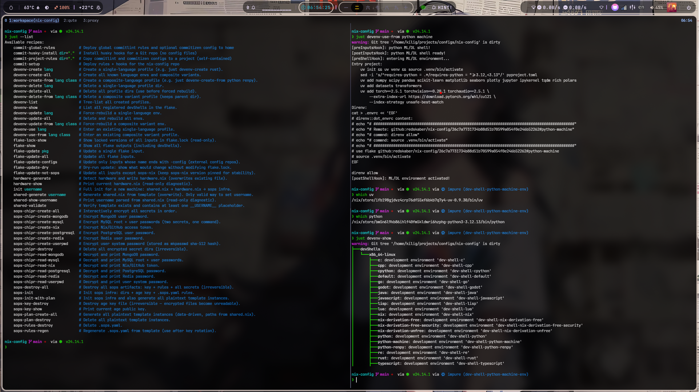
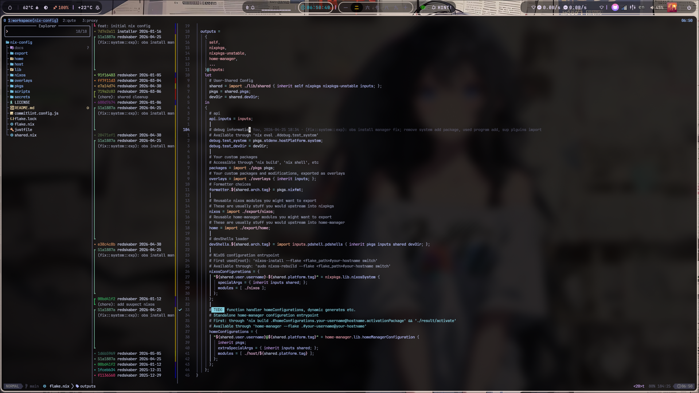
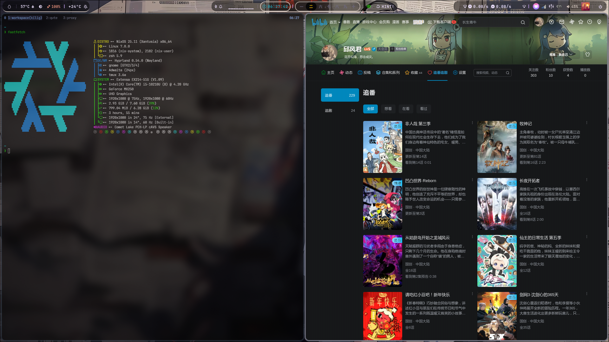
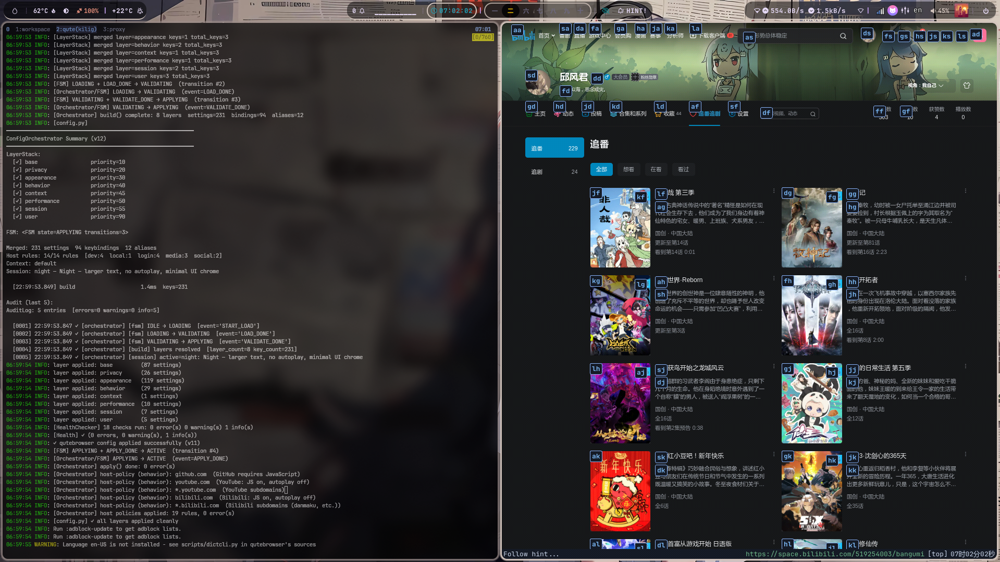
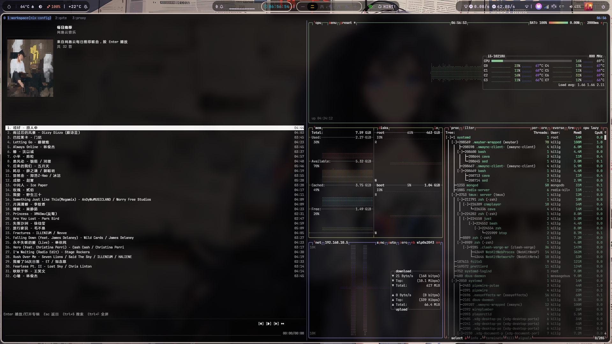

# nix-config

> 声明式、可复现、多平台的系统与开发环境管理
>
> 作者: [@Redskaber](https://github.com/Redskaber) · 构建于 Nix Flakes + Home Manager + SOPS-Nix + nix-darwin + disko

---

## 目录

1. [预览](#预览)
2. [架构总览](#架构总览)
3. [设计原则](#设计原则)
4. [目录语法 — 平台分发层的文法](#目录语法--平台分发层的文法)
5. [目录结构](#目录结构)
6. [核心机制](#核心机制)
7. [快速开始](#快速开始)
8. [跨平台支持](#跨平台支持)
9. [测试体系](#测试体系)
10. [CI/CD 完整执行流](#cicd-完整执行流)
11. [日常操作速查](#日常操作速查)
12. [已知边界与设计债](#已知边界与设计债)
13. [路线图](#路线图)
14. [深入文档](#深入文档)

> 深度内容按受众分层至 `docs/`（[文末索引](#深入文档)）：架构内幕 · 六 Phase 全程 ·
> 九情景 secrets 手册 · 98 recipe 全参考 · CI 深度手册——README 只保留入口层。

---

## 预览

<details>
<summary>part tools summary</summary>












</details>

---

## 架构总览

系统采用严格的层级化管道架构，每层职责单一、边界明确，依赖方向自上而下单向流动。

```
┌────────────────────────────────────────────────────────────┐
│  ENTRY LAYER  ·  flake.nix                                 │
│  统一入口 · 输入声明 · 一行委托 faces.nix · api.inputs     │
│  （目标构造已在 SHARED LAYER 生产，链接层组装，R31）       │
└──────────┬──────────────────────────────┬──────────────────┘
           │                              │
┌──────────▼──────────┐       ┌───────────▼──────────────────┐
│  SYSTEM LAYER       │       │  USER LAYER                  │
│  platform/<tag>/    │       │  platform/<tag>/home/        │
│  system/default.nix │       │  home/default.nix（门即      │
│  硬件·驱动·安全·服务│       │  payload，arch 轴已退役）    │
│  core/ · dm/ · wm/  │       │  应用·开发环境·窗口管理器    │
│  （域地址显式，     │       │  home/（共享库）core·env·wm  │
│   语法 v4）         │       │                              │
└──────────┬──────────┘       └───────────┬──────────────────┘
           │                              │
           │      ┌───────────────────────▼──────────────────┐
           │      │  HOST DISPATCH LAYER  ·  platform/       │
           │      │  平台目录 = 目标机描述（target double    │
           │      │  的 platform 半边；arch 半边为管道值）： │
           │      │  平台主序·域显式（语法 v4）：            │
           │      │  system/ = 系统域（default.nix = 门，    │
           │      │  有系统形态的平台才有）；home/ = 用户    │
           │      │  域（门即 payload）·  文件存在性         │
           │      │  = 能力声明                              │
           │      └───────────────────────┬──────────────────┘
           │                              │
┌──────────▼──────────────────────────────▼──────────────────┐
│  SHARED LAYER  ·  lib/shared/                              │
│  两阶段初始化：lang(前端) → runtime(IR 合成)               │
│  目标工厂 targets.nix：hosts/ 清单 → caps 分类 →           │
│  nixos / darwin / standalone-HM 三类 closure 发射器        │
│  + 两个 toplevel 投影面（R31 迁入）；链接层 faces.nix：    │
│  checks 五门聚合 / module-docs / pdsh / tests 单次构造     │
│  （生产端：faces.nix 只写 inherit (targets) …；            │
│   策略 IR 每主机单实例化，T5.10）                          │
└──────────────────────────────┬─────────────────────────────┘
                               │
┌──────────────────────────────▼─────────────────────────────┐
│  SECRET LAYER  ·  secrets/ + .sops.yaml                    │
│  Age 加密 · SOPS 管理 · 最小权限 · 运行时注入              │
│  TMPL → KEY → RULE → PLAIN → CIPHER → /run/secrets/        │
└──────────────────────────────┬─────────────────────────────┘
                               │
┌──────────────────────────────▼─────────────────────────────┐
│  TEST LAYER  ·  tests/                                     │
│  6 平面 · 101 tests + 6 仓库卫生门 = 107 checks            │
│         · nmt(零VM) + QEMU · CI 平面整面交接               │
└────────────────────────────────────────────────────────────┘
```

**数据流向（管道）：**

```
shared.nix (策略)
    ↓ just shared-generate
lib/shared (两阶段初始化：lang → runtime)
    ↓ specialArgs / extraSpecialArgs
lib/shared/targets.nix (目标工厂：hosts/ 清单 → caps 分类 → 发射器)
    ↓ 产出成品 closures + toplevel 投影面
lib/shared/faces.nix
    ↓ inherit (targets) nixosConfigurations / homeConfigurations / darwinConfigurations / hostToplevels / darwinToplevels（链接层，R31）
flake.nix → 一行委托 faces.nix（入口层只剩输入注册）
    ↓ 三门分发（发射器纯数据驱动目录引用，语法 v4：域地址显式）：
    ↓   nixos 系统门 platform/<tag>/system → default.nix
    ↓   · darwin 单门 platform/<tag>/system（系统路由，HM 内乘 import ../home）
    ↓   · HM 门 platform/<tag>/home → default.nix（门即 payload，arch 退役）
platform/nixos/{system/{default.nix, core/ dm/ wm/}, home/default.nix} + home/（模块树；app 树按 app-set 重量级路由：full/lean/none）
    ↓ sops-nix (initrd 阶段)
/run/secrets/ (运行时 secret 挂载)
    ↓ systemd services
运行中的系统
```

---

## 设计原则

| 原则         | 体现                                                                                                          |
| ------------ | ------------------------------------------------------------------------------------------------------------- |
| **依赖倒置** | `lib/shared` 定义抽象 schema/enum，上层模块依赖抽象接口而非具体实现；`shared` 作为 specialArgs 注入           |
| **管道流**   | `shared.nix → lib/shared → targets → flake → platform/home → modules` 单向数据流，无反向依赖；三段式镜像编译器管道：lang（frontend）→ runtime（IR 合成）→ targets.nix（codegen） |
| **层级化**   | entry / host-dispatch / system / user / shared / secret / test 七层，职责不交叉，层间通过 `shared` 通信       |
| **增量模式** | 每个子目录均为独立模块，可单独启用/禁用；`imports` 列表即模块注册表                                           |
| **策略管理** | `shared.nix` 集中声明 platform · drive · wm · dm · shell · editor 等所有策略选项，单一真相源                  |
| **分发层收敛** | 平台语义只回答一次：`enum.platform` 行携带 `caps` 能力向量与策略载荷（home-prefix · btop · trace-tools），targets 分类器、发射器与全部叶子读同一张表（`shared.caps.*` / `shared.platform.value.*`）；配置树中零 if-else、零原始 tag 比较（T4.0，借鉴编译器多层管道：后续 pass 查询目标描述，绝不重新词法分析） |
| **状态机**   | `lib/shared/lang/enum.nix` 通过 `nix-types` enum 约束合法状态集合，非法值在求值阶段即报错                    |
| **生命周期** | devShell 四阶段钩子：`preInputsHook → postInputsHook → preShellHook → postShellHook`                          |
| **边界明确** | system layer 不感知用户配置；user layer 不直接操作硬件；host layer 是唯一的平台感知点                         |
| **生成不变** | `shared.nix` 由模板生成（覆盖写入），不可 sed 原地 patch；`.sops.yaml` 同理                                   |
| **数据驱动** | secret 别名注册表是数据文件（`secrets/registry.toml`，CRUD 动词管理），路径唯一来源于 `shared.nix`；查询经 sqlite 数据库缓存（`secrets/.cache/`，输入漂移自动重建）；CI checks 按平面整面交接（`api.checks.planes`，T7.3）    |
| **通信协议** | 层间通过 `shared` attrset 传递（`specialArgs`/`extraSpecialArgs`）；`api.inputs` / `api.shared` / `api.targets` / `api.checks.planes` 暴露 flake 侧信息供脚本与 CI 查询 |
| **数据与解释器分离** | 机器事实归 `hosts/`（facter.json 硬件数据 · disk.nix 磁盘布局 · persist.nix 状态策略），解释能力归平台结构树（nixpkgs facter 模块 · disko 注册 · impermanence + 回滚机制）；主机入口只做一行接线（T5.12/T5.13/T5.14） |

---

## 目录语法 — 平台分发层的文法

平台分发层（`platform/`）遵循**平台主序 · 域显式**文法（v4）。每个平台标签一个目录，目录内恰两个保留域名——`system/` 与 `home/`，各持自己的 `default.nix` 门。读目录即知平台形态，读路径即知域。

```
platform/<tag>/
├── system/             # 系统域 —— 有系统形态的平台才有（nixos · darwin · nixos-wsl）
│   ├── default.nix     # 系统门：entry and dispatch（子系统注册 + hosts facts）
│   └── core/ dm/ wm/ … # 系统配置（subdir | file，自由生长）
└── home/               # 用户域 —— 每个平台都有
    └── default.nix     # home 门：entry and dispatch（门即 HM payload 模块）
```

**文法六律（v4）：**

1. **两个域，两个显式地址。** `system/` 与 `home/` 是 `<tag>/` 下恰有的两个保留名，各持 `default.nix` 门——`platform/<tag>/system` 与 `platform/<tag>/home` 在发射器两侧完全对称（v3 的系统域是隐式顶层、用户域低一级；v4 给两域同等显式门——更明确、更通用）。文件存在性 = 能力声明（caps 表在文件系统上的投影）：`linux/`、`wsl/` 没有 `system/`，因为它们没有系统形态。
2. **每活门一边界，门即内容装配点。** 系统门 = 子系统注册表（`./core ./wm ./dm` + `../../../hosts/<h>` facts）；home 门 = HM 入口模块本身（base facts + 跨平台用户库 `../../../home/{core,env,wm}` 分发）。
3. **arch 轴不建模——分发路径下的自然选择。** 所有 arch 走同一管道（每平台一条流）：arch 差异由发射器 `system` 参数与 per-host pkgs 合成（`runtime.nix` 以 `{ system = arch.tag; }` 实例化）在 nixpkgs 层吸收；app 自带 arch 标签，是否启用由分发层（`lib/shared/`）处理完整后自动判断。v3 的 `home/<arch>.nix` payload 行已退役——target double 保留 platform 半边为目录地址，arch 半边降为管道值。
4. **一个路径只有一个含义。** 顶层同名异义债务为零；域读自目录名而非层级位置（v2 读文件名，v3 读层级，v4 读显式域目录）。
5. **声明而不存在的路径在 eval 期响亮失败。** 目录路由是数据驱动插值（`platform/${shared.platform.tag}/system`），落到不存在的门即报错。
6. **分发逻辑只在分发层。** 发射器以 IR 投影 tag（零 if-else、零原始 tag 比较——T4.0：后续 pass 查询目标描述，绝不重新词法分析）；配置树不感知平台决策，子系统路由只有数据形态。

**五平台形态表：**

| platform | system/ | home/ | 目录形态 |
| -------- | ------- | ----- | -------- |
| `nixos` | ✅ `default.nix` + `core/ dm/ wm/` | ✅ `default.nix`（门即 payload） | 双门双域，地址对称（策略：standalone HM 秒级切换、独立于系统世代回滚） |
| `darwin` | ✅ `default.nix`（单门折叠：HM module mode 内乘，`import ../home` 跨域引用路径可见）+ `nix/`（nix settings：fleet cache 拉取侧，`shared.const` 按值消费） | ✅（门即 payload，由系统门挂载，无独立门） | 双目录单活门 |
| `linux` | ✗ | ✅ `default.nix` | home/ 即全部 |
| `wsl` | ✗（Windows 宿主持有内核侧） | ✅ `default.nix` | home/ 即全部 |
| `nixos-wsl` | ✅ 薄门：`../../nixos/system` 复用 + NixOS-WSL 解释器（T7.1） | ✅ 薄门：`imports = [ ../../nixos/home ]` | 双门双薄门：读门即知「nixos customs + WSL 解释器」 |

**文法机器强制（T46）：** `platform-grammar-check`（第五个仓库卫生门）以纯 `readDir` 树形遍历在构建期断言上述形状——`platform/` 顶层只允许平台标签目录；`<tag>/` 下只允许 `system/`+`home/` 两个保留子域（至少其一）；每个域目录必须持正则 `default.nix` 门；域级负载只允许模块目录（裸 `.nix` 文件 = v3 arch 行尸体类；无门目录 = 对包括可达性门在内的所有门不可见）。run #369 的 82 具 v3 尸体全部属于此缺陷类——可达性门在图游走后抓到它们，形状门在地址空间层直接拒绝（零求值成本）。文法本身演进（新增保留域）时，`tests/platform-grammar.nix` 的 `reservedDomains` 与本节六律同一提交更新。

**子系统路由的两种形态（零 if-else）：**

```nix
# 单选（目录插值）：platform/nixos/system/dm/default.nix
imports = [ ./${shared.display-manager.tag} ];      # ly → ./ly

# 多选（map 路由）：platform/nixos/system/core/drive/default.nix
imports = builtins.map (drive: ./${drive}.nix) shared.drive.value;
# shared.drive.value = [ "intel" "nvidia" ] → imports [ ./intel.nix ./nvidia.nix ]
```

---

## 目录结构

顶层七层，各层一个目录、一条职责（**完整注释树**——每个文件干什么——见
[docs/architecture/tree.md](docs/architecture/tree.md)）：

```
nix-config/
├── flake.nix          # entry layer：输入声明 + 一行委托（outputs 由 lib/shared/faces.nix 链接组装，R31）
├── shared.nix         # 策略层（just shared-generate 生成，禁止手动编辑用户名）
├── lib/shared/        # 共享层：lang（前端）→ runtime（IR 合成）→ targets.nix（codegen）→ faces.nix（链接）
├── platform/          # 分发层：平台主序·域显式（nixos · linux · darwin · wsl · nixos-wsl 五形态）
├── home/              # 用户层（HM）：core / wm / env 三域（无根入口，由各平台 home 门导入）
├── hosts/             # 主机事实：facter.json · disk.nix · persist.nix + shared.nix 覆盖
├── secrets/           # SOPS 密文（chipr/）+ 明文模板（plan/，不入仓）
├── export/            # 可复用模块输出（nixosModules · homeModules）
├── overlays/ · pkgs/  # nixpkgs overlay（additions/patches）· 自定义 derivation（wslview shim）
├── tests/             # 测试层：6 平面（smoke/nixos/home/lib/integration/nmt）
├── scripts/           # just 子模块（14 组动词）+ sh 工具（计数/轮换/导出/注册表引擎）
├── docs/              # 深度文档（按受众分层，见文末「深入文档」索引）
└── justfile           # 任务自动化入口（裸 just 打印 start-here 地图）
```

**规模事实**（计数由 `tests/docs-ssot.nix` 机器锚定，T8.1）：`hosts/` 目录实现多主机分发，
每台机器独立硬件事实 + 可选 `shared.nix` 覆盖，当前承载 **5 台主机**（nixos · vm · darwin · wsl · nixos-wsl）；
flake.nix（47 inputs）——nixpkgs 双通道（stable + unstable 第二实例）、5 个自建工具
flake（nix-types · pdshell · configuration-orchestrator · commit-config 及应用 flake）、
22 个外部配置仓（nvim · emacs · wezterm · hypr · waybar …，flake=false inputs）——
完整依赖图见 [docs/architecture/dependency-graph.md](docs/architecture/dependency-graph.md)。

---

## 核心机制

十一层机制，一层一段深度内幕（[docs/architecture/mechanisms.md](docs/architecture/mechanisms.md)）：

| # | 机制 | 一句话本质 |
| --- | --- | --- |
| 1 | 共享层 · 两阶段初始化 | `lang`（前端：类型/枚举/schema，无 pkgs）→ `runtime`（IR 合成：caps/pkgs/i18nScope）；scfpath 可覆盖，多机器各自策略 |
| 2 | 策略层 · shared.nix 生成 | 模板 + 覆盖写入（不可 sed 原地 patch）；单一策略真相源 |
| 3 | 分发层 · targets.nix | hosts/ 清单 → caps 分类 → nixos/darwin/standalone-HM 三类 closure 发射器 + 两个 toplevel 投影面（R31）；链接层 faces.nix 只 `inherit` 成品，flake.nix 一行委托 |
| 4 | 开发环境管道 · pdshell | 每语言一目录的 devShell 工厂；四阶段钩子；combinFrom 组合 |
| 5 | 安全层 · SOPS + Age | TMPL → KEY → RULE → PLAIN → CIPHER → /run/secrets 六相分层 |
| 6 | 配置编排器 · orc | wallust 主题色跨应用注入（activation hook，含 waybar 主题重载） |
| 7 | 用户环境层 · home/env | 目录即环境域；每文件一个 attrset（key = shell 名） |
| 8 | 外部配置仓库 | flake=false inputs ×22——dotfiles 外置，flake.lock 锁 rev |
| 9 | 提交规范 | Husky + Commitlint + Commitizen 零 node_modules（commit-config flake） |
| 10 | 多主机支持 · hosts/ | 机器事实（facter/disk/persist）与解释器（平台结构树）分离；主机入口一行接线 |
| 11 | 服务按需启动 | service-profile：`install` 与 `autostart` 分离（dev-on-demand / server-pg-only …） |

---

## 快速开始

> 完整六 Phase（含每步前置条件与注意事项）见
> [docs/guides/quickstart.md](docs/guides/quickstart.md)；secrets 按情景的
> 查阅手册见 [docs/secrets/scenarios.md](docs/secrets/scenarios.md)。

**Phase 0 — Nix + just 就绪**（NixOS 自带，跳过）：

```bash
curl -L https://install.determinate.systems/nix | sh -s -- install   # 非 NixOS
mkdir -p ~/.config/nix
echo "experimental-features = nix-command flakes pipe-operators" >> ~/.config/nix/nix.conf
nix shell nixpkgs#just nixpkgs#git           # just 不全局安装，一次性进入
```

**Phase 1 — 克隆 + 策略与密钥基线**：

```bash
git clone https://github.com/Redskaber/nix-config /etc/nix-config && cd /etc/nix-config
just init <username>                         # = 策略生成 + 硬件探测 + user age 密钥 + .sops.yaml 基线
# 服务器机双 key 直达：just key-new-host <alias> → just init <username> <alias> <age1…>
```

**Phase 2 — secrets 就绪**：

```bash
nix shell nixpkgs#mkpasswd --command just secret-set-all   # 逐项录入（输入即加密，明文不落盘）
just secrets-verify                          # 收件人一致性审计（期望全绿）
```

**Phase 3 — 首次部署**：

```bash
just hosts-list                              # 数据驱动主机清单（hosts/ 目录）
sudo nixos-install --flake /etc/nix-config#<host>    # A. 全新 NixOS（LiveISO 分区挂载后）
just nixos-switch <host>                     # B. 接管已有 NixOS
just home-switch <host>                      # C. 非 NixOS（HM 层）；macOS: darwin-rebuild switch --flake .#<host>
```

**Phase 4/5 — 验证回滚与 day-2**：

```bash
just nixos-test <host>                       # 试验性切换（不写 boot 条目，重启即弃）
just nixos-boot <host>                       # 只设下一代引导不激活（T10.2）
sudo nixos-rebuild rollback                  # 一键回上一代
just flake-update-not-sops && just nixos-switch <host>    # 例行更新（sops-nix 锁版本）
```

---

## 跨平台支持

| 平台         | 系统层 | 用户层 | 开发环境               |
| ------------ | ------ | ------ | ---------------------- |
| NixOS x86_64 | 完整   | 完整   | 全部（25 devShells）  |
| Linux x86_64 | —      | 完整（+ nixGL） | 全部          |
| macOS ARM64  | nix-darwin 闭包（构建级验收：CI darwin 腿原机构建，T8.3；activation 待真机） | 完整（module mode；lean app-set） | CLI 为主 |
| WSL2         | NixOS-WSL 闭包（eval 级验收，T7.1；activation 待 Windows 宿主） | 完整（+ wslview shim，caps.wsl 门控于共享树） | 全部（需启用 systemd） |

---

## 测试体系

测试套件覆盖 6 个平面，总计 **107 checks = 101 tests + 1 pre-commit-check + 1 docs-ssot-check + 1 testscript-syntax-check + 1 module-reachability-check + 1 platform-grammar-check + 1 cache-ssot-check**（计数与 TOC 导航由 `tests/docs-ssot.nix` 机器强制——README 与 test-matrix 的计数锚点漂移、TOC 死链/孤儿节即 CI 红灯；本地速查仍可用 `scripts/sh/test-count.sh`，其输出与 CI summary 对账）：

| 平面        | 前缀           | 数量   | KVM            | 关注点                         | 典型时长 |
| ----------- | -------------- | ------ | -------------- | ------------------------------ | -------- |
| Smoke       | `test_`        | 1      | QEMU           | 基本系统完整性                 | ~1 min   |
| NixOS       | `nixos_`       | 30     | QEMU           | platform/nixos/* 模块 + 系统服务 | 2–10 min |
| HM          | `home_`        | 41     | QEMU           | home/* 包安装 + 运行时行为     | 2–8 min  |
| Lib         | `lib_`         | 12     | QEMU 256MB min | lib/shared 纯 Nix 表达式（含 orc 消费契约 + include-intent 守卫契约 + pdshell 加载器契约，T28/T30/T31） | <1 min   |
| Integration | `integration_` | 1      | QEMU full      | NixOS + HM 联合激活            | 5–15 min |
| **nmt**     | `nmt_`         | **16** | **✗ 零 VM**    | HM dotfile 内容断言（纯 eval） | <10 s    |

**nmt-Plane 特点：** 纯 Nix eval，无 QEMU，无 KVM，利用 `scrubDerivations` 将包替换为 `@pkg-name@` 占位符，避免触发真实构建（白名单外的包一律擦洗）。适合 CI 最快反馈路径。

**nmt vs HM-Plane 互补：**

```
home/core/exp/sys/base/fd.nix
  ├─ nmt_home_core_exp_sys_base_fd     dotfile 内容断言（纯 eval，<10s）
  │    tests/nmt/home/core/exp/sys/base/fd.nix
  │    .config/fd/ignore: .git/ / *.bak 条目
  └─ home_core_exp_sys_base_fd          运行时行为（QEMU VM，~2min）
       tests/home/core/exp/sys/base/fd.nix
       fd --version, fd finds files by pattern
```

**CI 平面整面交接（无需手动维护列表，T7.3）：**

```bash
# 平面成员由 tests/default.nix 的 planes 面声明——新测试按构造落位其平面；
# CI 直接把整面交给 nix-fast-build（从锁定 nixpkgs 解析，零 registry 漂移）：
nix-fast-build --no-nom --skip-cached -j "$(nproc)" \
  --flake ".#api.checks.planes.nixos"

# 平面分组可独立寻址（与 .#checks.<system> 同形态的 derivation 属性集）：
nix eval ".#api.checks.planes.nmt" --apply builtins.attrNames --json
```

**运行命令：**

```bash
# 全量（需要 KVM；深层求值无 KVM 也可跑 --no-build）
nix flake check

# nmt only（最快，无 QEMU）
nix eval .#checks.x86_64-linux --apply \
  'cs: builtins.attrNames (builtins.filterAttrs (n: _: builtins.substring 0 4 n == "nmt_") cs)' \
  --json | python3 -c "import sys,json; [print(c) for c in json.load(sys.stdin)]" \
  | xargs -I{} nix build ".#checks.x86_64-linux.{}" --no-link

# 单个
nix build .#checks.x86_64-linux.nmt_home_core_exp_sys_base_git -L
nix build .#checks.x86_64-linux.nixos_core_srv_db_postgresql -L
nix build .#checks.x86_64-linux.integration_hm_activation -L

# export/ 模块文档再生（docs.nix 侧通道发射器，T5.3）
nix build .#module-docs    # → result/options/{home-,nixos-}<module>.md + index
```

**nmt 获取机制：** sourcehut 对 Nix fetcher UA 返回 HTTP 403，因此使用 `github:Redskaber/nmt`（mirror）+ `flake = false`，通过 store path 直接引用。`buildHomeManagerTest` 包装器在 `tests/nmt/default.nix` 中自行实现（nmt 原生不提供此函数）。

详见 [`docs/tests/test-matrix.md`](docs/tests/test-matrix.md) · [`docs/tests/nixosTest.md`](docs/tests/nixosTest.md) · [`docs/tests/nmt.md`](docs/tests/nmt.md)

---

## CI/CD 完整执行流

### 为什么 Nix 配置需要 CI/CD

每次变更 nix-config 都等价于声明一个新的系统状态。CI 的核心价值：

1. **求值检查** — 捕获 Nix 语法/类型错误（早于 nixos-rebuild 失败）
2. **深层求值** — 面分片强制（T15.1）：api 信封 + 逐主机 toplevel drvPath + 杂项 checks + 完备性对账（全部 107 checks 必须被平面或杂项清单拥有；单进程 `nix flake check` 因内存累积地板已退役）
3. **Secret 完整性** — 验证加密文件结构正确，`secrets/plan/` 未被提交
4. **测试覆盖** — 101 tests 覆盖 nixos/home/lib/integration/nmt 平面
5. **自动更新** — 每周日自动更新 flake inputs 并开 PR

### 实际 Pipeline（10 阶段，最大并行）

```
push / PR
    │
    ├─► [STAGE 1: Lint & Evaluate]     静态分析 + 浅层 eval（< 2 min）
    │       ├── nix eval .#formatter.*.name          (formatter 可求值)
    │       ├── nix eval .#devShells.* attrNames     (devShells 非空)
    │       ├── nix eval .#nixosConfigurations attrNames  (结构验证)
    │       ├── nix eval .#homeConfigurations attrNames
    │       ├── nix eval .#checks.* attrNames + 平面计数
    │       ├── statix check .                       (Nix 反模式检查)
    │       ├── nixfmt check / deadnix check
    │       ├── Build pre-commit-check derivation
    │       └── Build docs-ssot-check derivation     （文档计数锚点）
    │           + Build testscript-syntax / module-reachability /
    │             platform-grammar / cache-ssot derivations
    │
    ├─► [STAGE 2: Deep Evaluation]     深层求值（硬门禁，面分片形态）
    │       └── 面分片强制：api 信封 + 逐主机 toplevel drvPath
    │           + 杂项 checks（docs-ssot/pre-commit）+ 完备性对账
    │           （107 checks 必须被平面或杂项清单拥有——新测试
    │           文件未注册平面即红；短命进程替换单进程 flake
    │           check：内存安全 + 墙钟 120m→预计 15-25m；
    │           纯求值腿：无 magic-nix-cache + infra 签名单次重试）
    │
    ├─► [STAGE 3: nmt-Plane]           HM dotfile 断言，纯 eval，无 KVM（< 1 min）
    │       └── nix-fast-build --flake .#api.checks.planes.nmt（并行求值+构建）
    │
    ├─► [STAGE 4: devShells dry-run]   逐成员 dry-run（面 attrNames）
    │       └── 枚举 = devShells 面自身 attrNames（25 员点名；新 shell 按构造入列，
    │           零 CI 侧维护；失败成员点名——归因哲学）
    │
    ├─► [STAGE 4.5: Output Faces]     无独立腿的输出面 drvPath 强制（并行）
    │       ├── packages.* 逐成员 drvPath（wslview 教训——deep-eval 的
    │       │   面覆盖是路径依赖的：前面红，后面坏不见；失败成员点名）
    │       ├── homeConfigurations.* activationPackage.drvPath
    │       │   （home 平面测试是 nixosTest VM，从不触此面）
    │       └── darwinConfigurations.* system.drvPath（host-toplevels 的
    │           darwin 求值步在 deep-eval 绿后才跑，本腿不受此门）
    │
    ├─► [STAGE 5: Security Audit]      SOPS 完整性审计（并行）
    │       ├── 供应链钉版契约：全部 action 引用必须 40-hex SHA（fail-fast）
    │       ├── secrets/chipr/*.yaml 必须含 sops: 元数据
    │       ├── secrets/plan/ 不得被 git 追踪
    │       ├── .sops.yaml 含 age: + creation_rules:
    │       └── .nix 文件扫描硬编码 token/password
    │
    ├─► [STAGE 6: VM Tests]            QEMU 测试，按平面并行子矩阵（需 KVM）
    │       ├── 每腿一平面，整面交 nix-fast-build（nix-eval-jobs 并行求值
    │       │   + 流水线构建，--skip-cached 对接 magic-nix-cache）：
    │       ├── smoke        — 基线（1）
    │       ├── nixos        — 系统模块（29）
    │       ├── home         — HM 模块（41）
    │       ├── lib          — lib 纯表达式（5）
    │       └── integration  — NixOS + HM 联合激活（1）
    │
    ├─► [STAGE 6.5: Host Toplevels]   系统闭包构建（无 KVM）
    │       ├── .#api.host-toplevels 整面交 nix-fast-build（inventory 驱动：
    │       │   nixos · vm · nixos-wsl——新 NixOS 主机按构造入列；
    │       │   cache.nixos.org 替代 + magic-nix-cache 跨次缓存）
    │       └── darwin 闭包跨系统求值步（linux 腿的零成本交叉检查；
    │           构建深度归 6.6 腿）
    │
    ├─► [STAGE 6.6: Darwin Toplevels]  darwin 闭包原机构建（macos-latest
    │       │   aarch64 runner，无需交叉工具链：api.darwin-toplevels 第六
    │       │   api 面整面交 nix-fast-build——同工具同纪律，inventory
    │       │   驱动，新 darwin 主机按构造入列）
    │
    └─► [STAGE 7: Summary]             汇总报告（always，即使前序失败）
```

**本地预检清单（push 前）· 部署工作流 · 世代管理细节 · 自动化更新策略**
→ [docs/ci/pipeline.md](docs/ci/pipeline.md)。

---

## 日常操作速查

> 全量动词面共 98 个 recipe，`[group]` 注解分 14 组——终端 `just --list` 或
> [docs/just/reference.md](docs/just/reference.md)；裸 `just` 打印 start-here 地图。

### deploy — 部署动词（nixos-rebuild 三语义 + HM + colmena 远程面）

```bash
just nixos-switch <host>       # = sudo nixos-rebuild switch --flake .#<host>（激活）
just nixos-test <host>         # test：试验性切换，重启即弃
just nixos-boot <host>         # boot：只设下一代引导不激活（T10.2）
just home-switch <host>        # standalone HM（→ <username>@<host>）
just hosts-list                # 主机清单（hosts/ 目录数据驱动）

just deploy-list               # colmena 部署面（= nixosHosts，T20.1）
just deploy <host>             # colmena 远程部署：构建→上传→激活（ssh，策略用户）
just deploy-local              # colmena 本机部署（apply-local --sudo）
```

### 开发环境 — devShells 与 profile

**可用 devShells 速查（25 个，`nix eval .#devShells.x86_64-linux --apply builtins.attrNames`）：**

| Shell 名称                     | 组合内容                              | 特性                          |
| ------------------------------ | ------------------------------------- | ----------------------------- |
| `rust`                         | rustc + cargo + rust-analyzer         | clippy · rustfmt              |
| `go`                           | go + gopls + delve                    | 中国镜像 · 项目级缓存         |
| `python`                       | python314 + uv + pyright              | ruff · bytecode 缓存隔离      |
| `python-machine`               | C + Python + gcc.cc.lib               | ML/DL 工具链 · GPU 指引       |
| `python-renpy`                 | python314 + renpy + unrpyc            | Visual Novel 开发             |
| `cpp`                          | pure LLVM (libc++ + clangd)           | lld · lldb · bear · ccache    |
| `c`                            | clang + clangd + lld                  | bear · ccache · cmake · ninja |
| `asm`                          | nasm + binutils                      | 汇编                          |
| `java`                         | temurin-21 + maven + jdt-ls           | gradle                        |
| `typescript`                   | node26 + tsc + tsx                    | typescript-language-server    |
| `javascript`                   | node26 + biome                        | pnpm · yarn                   |
| `nix`                          | nix + nil + statix + nixfmt           | deadnix · nvd                 |
| `nix-derivation-free`          | + nix-output-monitor + nixpkgs-review | PR 审查工作流                 |
| `nix-derivation-unfree`        | + patchelf + sbomnix + gpg            | 闭源软件构建 · 合规           |
| `nix-derivation-free-security` | + vulnix                              | 安全扫描                      |
| `nix-nonfmt`                   | 无 formatter 干扰的裸 nix shell        | 脚本编写                      |
| `re`                           | LLVM + 完整逆向工具链                 | pwntools · frida · ghidra     |
| `lua`                          | lua54 + luajit + lua-language-server  | stylua · luarocks             |
| `lisp`                         | sbcl + rlwrap                         | pkg-config · gcc              |
| `zig`                          | zig + zls                             |                               |
| `default`                      | 全语言 combinFrom 合并                | 综合开发环境                  |
| `cpython`                      | C + C++ + Python 组合                 |                               |
| `godot`                        | C + C++ + Python + godot              | 游戏开发                      |
| `makeOs`                       | asm + c + qemu_full + just            | OS 实验环境                   |
| `rs_compiler_dev`              | rust + 编译原理工具链                  | rs 开发                       |

```bash
# 一次性进入（不保存 profile）
nix develop .#rust · .#python · .#python-machine …
# 持久化 profile（离线可用；命名 <username>-<lang>[-<class>]，落 ~/.local/state/nix/profiles/dev/）
just devenv-create rust                        # 单语言
just devenv-create-from python machine         # 复合变体（C + Python ML/DL）
just devenv-use [-from] <lang> [<class>]       # 进入已有
# direnv 自动激活（推荐）
echo "use flake github:Redskaber/nix-config#python-machine" > .envrc && direnv allow
```

### secrets — 速查表（一条命令一个意图）

| 意图 | 命令 |
| --- | --- |
| 我有哪些加密内容 / 缺哪个 | `just secrets-list` |
| 注册一个新秘密（三层一次写全） | `just secrets-add <alias> <rel-path> [prompt]` |
| 改注册行的提示语 / 变换 | `just secrets-edit <alias> [prompt] [transform]` |
| 退役一个秘密（先销毁密文） | `just secrets-remove <alias>` |
| 单个秘密全档案（不解密） | `just secrets-show <alias>` |
| 声明 ↔ 注册表漂移视图 | `just secrets-declared` |
| 注册库缓存状态 | `just secrets-db` |
| 录入 / 改一个秘密 | `just secret-set <alias>` |
| 看一个秘密 | `just secret-get <alias>` |
| 编辑一个秘密 | `just secret-edit <alias>` |
| 全部录入（顺序） | `just secret-set-all` |
| 谁能解密（钥匙/规则总览） | `just secrets-status` |
| 规则 ↔ 密文一致性 | `just secrets-verify` |
| 改了规则后对齐密文 | `just secrets-sync` |
| 生命周期地图 | `just secrets-guide` |

> 层级模型一行：TMPL → KEY → RULE → PLAIN → CIPHER → `/run/secrets/`；
> 入口 `just secrets-guide`（状态机 + 动词矩阵 + 情景流）。
> 九情景手册（day-one / 双 key / 接入服务器 / 第二台机 / 双向轮换 / 失陷应急 /
> 新增 / 销毁）：[docs/secrets/scenarios.md](docs/secrets/scenarios.md)；
> 轮换 runbook：[docs/secrets/rotation.md](docs/secrets/rotation.md)。

### 世代与回滚

```bash
sudo nixos-rebuild rollback                                                   # 回上一代
sudo nix-env --profile /nix/var/nix/profiles/system --switch-generation <N>   # 指定世代
sudo /nix/var/nix/profiles/system/bin/switch-to-configuration switch
```

---

## 已知边界与设计债

机器可断言的部分已全部由六道仓库卫生门承载；本表是门管不到的残余边界——
需要真机、需要所有者决策或需要外部协作的事项账本，显式追踪防止静默蒸发
（豁免类条目在对应门内另有 STALE-red tripwire 兜底）。

| # | 边界 / 债 | 现状 | 归属 |
| --- | --- | --- | --- |
| 1 | darwin activation 待真 Mac | aarch64 闭包已 CI 原机构建（macos-latest），激活与切换语义未在真机验收 | 真机 |
| 2 | hosts/nixos facter 迁移 | 仓库侧全量落地（`just hardware-migrate` 四步 + targets 三律测试），root 探测门控真机执行 | 真机 |
| 3 | cachix 推送步待激活 | 推送闭包已实证（wechat 762 MB），CI push 步待 secret 注入后生效 | 所有者 |
| 4 | sound 真机裁决 | 策略轴已落地（pipewire 默认 + none 枚举 + 双律锁定），控制台主机翻转待真机听感 | 真机 |
| 5 | 第二台机器 + ssh 公钥 | colmena 远程面与部署等价性门控已就绪，基策略 openssh-authKeys 仍空 | 硬件 |

---

## 路线图

- [x] CI 全量 build 验证（nmt-Plane + QEMU VM tests，7 阶段流水线）
- [x] NixOS 测试套件（91 checks = 90 tests + 1 pre-commit-check〔内含 nixfmt/statix/deadnix 三钩子〕，6 个测试平面）
- [x] flake inputs 自动更新策略（定时 PR，每周日）
- [x] platform/ 平台分发层（nixos · linux · darwin · wsl，arch 路由）
- [x] api.inputs 暴露（just 脚本动态枚举 inputs，零硬编码）
- [x] AI CLI 工具集成（claude-code · opencode · gemini-cli · kiro-cli · cursor-cli · pi-coding-agent）
- [x] kiro 编辑器集成（home/core/exp/app/editor/kiro.nix）
- [x] nmt mirror 解决方案（sourcehut 403 规避，buildHomeManagerTest 自实现）
- [x] sops 数据驱动架构（零硬编码路径，phase-aware 信息源分离）
- [x] secrets just 生命周期重设计
- [x] tools.nix 工具库统一管理（nix-types / orc / pdshell 短路径访问）
- [x] hosts/ 多主机支持（per-machine facts + overrides；facter/disko 声明式形态，T5.12/T5.13）
- [x] service-profile 按需启动（install vs autostart 分离，dev-on-demand / full-autostart / server-pg-only / minimal）
- [x] editor-set / terminal-set / browser-set 集合路由（多选路由模式）
- [x] version 策略携带（variant 携带 {stateVersion, wine, swww} 策略）
- [x] shellIntegrations 统一（runtime 计算，8 个 base 模块复用）
- [x] match 穷尽性
- [x] 分发层收敛
- [x] 入口清爽化
- [x] 中间层命名收敛
- [x] pre-commit-hooks（nixfmt + statix + deadnix 自动检查）
- [x] services.just 按需启动命令（service-start/stop/status + db-start/stop/list）
- [x] 惰性模块加载
- [x] 模块文档自动生成
- [x] darwin 平台调用机制统一
- [x] darwin 发射器装配内聚
- [x] 平台架构完成
- [x] darwin 单门折叠
- [x] export/ 模块完善
- [x] 策略表补全
- [x] CI 构建深度
- [x] docs-SSOT 计数契约
- [x] CI 主机闭包构建腿
- [x] CI darwin 闭包构建腿
- [x] nixos-facter 替代 nixos-generate-config（声明式硬件发现）
- [x] disko 声明式磁盘分区（替代 hardware.nix 里的 fileSystems 硬编码）
- [x] Option/Result 类型化错误处理
- [x] 可观测性（prometheus exporters + loki 日志 + grafana dashboard）
- [x] 健康检查（数据库服务加 systemd HealthCheck）
- [x] 树卫生
- [x] impermanence 实验性
- [x] NixOS-WSL 第五系统形态
- [x] 输出面独立强制腿
- [x] CI 纯求值腿基础设施解耦
- [x] CI 深层求值面分片化
- [x] 供应链 actions SHA 钉版
- [x] sound 语义半部裁决卷宗
- [x] devShells 腿成员枚举数据驱动
- [x] hosts/nixos facter 迁移的仓库侧全量落地
- [x] colmena 部署面落地

---

## 深入文档

深度内容按受众分层至 `docs/`——README 只保留入口层，本节是全文索引：

| 受众 | 文档 | 内容 |
| --- | --- | --- |
| 架构理解 | [architecture/mechanisms.md](docs/architecture/mechanisms.md) | 核心机制十一层内幕 |
| | [architecture/tree.md](docs/architecture/tree.md) | 完整注释树 |
| | [architecture/dependency-graph.md](docs/architecture/dependency-graph.md) | 47 inputs 依赖图 |
| | [architecture/external-repos.md](docs/architecture/external-repos.md) | 外置仓库分层分类（四类 × 四仓） |
| | [architecture/nix-types.md](docs/architecture/nix-types.md) | 类型系统集成裁决 |
| CI/CD | [ci/pipeline.md](docs/ci/pipeline.md) | 缘起、本地预检与部署流 |
| 上手 | [guides/quickstart.md](docs/guides/quickstart.md) | 六 Phase 从 0 到部署 |
| | [guides/extending.md](docs/guides/extending.md) | 添加应用 / 语言环境 / Secret / 策略 |
| | [guides/cache.md](docs/guides/cache.md) | 缓存本地拉取与推送 |
| 裁决卷宗 | [guides/sound-adjudication.md](docs/guides/sound-adjudication.md) | sound 语义半部（债 #9） |
| 日常运维 | [just/reference.md](docs/just/reference.md) | 98 recipe × 14 组全参考 |
| 模块开发 | [modules/interface-standards.md](docs/modules/interface-standards.md) | 模块接口标准（改造即接线） |
| secrets | [secrets/scenarios.md](docs/secrets/scenarios.md) | 九情景手册 |
| | [secrets/rotation.md](docs/secrets/rotation.md) | 钥匙层级与轮换 runbook |
| 测试 | [tests/test-matrix.md](docs/tests/test-matrix.md) | 测试矩阵（六平面计数） |
| | [tests/nixosTest.md](docs/tests/nixosTest.md) | NixOS 测试完全手册 |
| | [tests/nmt.md](docs/tests/nmt.md) | NMT 镜像方案完全指南 |
